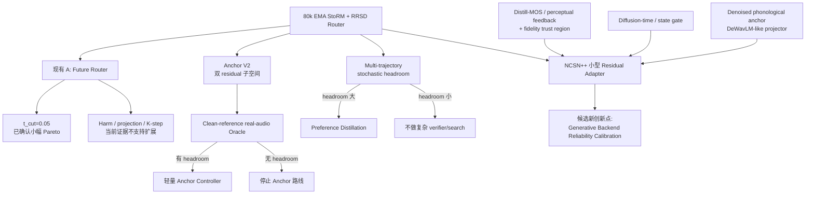
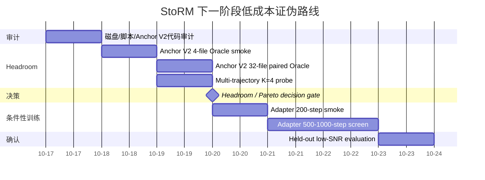

# StoRM / SGMSE 可行新创新方向深度研究报告

## Executive Summary

现有证据已经相当明确：**不应再把主要资源投入到“更复杂的 Future Router/Harm Head”或“继续调 Speaker InfoNCE/Prototype”上**。已有整句策略 Oracle 在 SI-SDR 容忍 0.05 dB 时只剩约 `+0.00361 DNSMOS-OVRL` headroom，而当前 Speaker 路线也没有产生独立身份收益；这两个结果都说明原 A/B 的当前形态已接近“继续复杂化但收益很小”的区域。fileciteturn0file0

我建议把下一阶段研究中心转向**生成式后端本身的可控校准**，但在训练前先做两个低成本上限实验：其一是利用仓库已经存在的 **Anchor V2 双残差方向**做真实语音 Oracle；其二是利用扩散随机性做 **multi-trajectory Oracle / verifier headroom**。只有确认这两种“后端自由度”中存在明显大于 `+0.003~0.005 OVRL` 的空间，才值得微调 NCSN++。fileciteturn0file0

如果上限成立，最值得训练的方案不是重新全量训练 NCSN++，而是**冻结 StoRM 前端和大部分 NCSN++，只训练 diffusion-time-aware residual adapter / LoRA，并使用感知质量 surrogate + reconstruction trust region 约束**。这一路线与 MetricGAN 系列的“直接面向质量指标”、Distill-MOS 的轻量 MOS 估计、UNIVERSE++ 的低秩适配、以及近年的生成式 SE 感知训练研究有清晰联系，但需要特别防范 Goodhart 式 metric gaming。citeturn3search0turn2search1turn4view1turn7search4turn7search0

综合**创新潜力、与你现有代码的距离、证伪成本和昨晚负结果**，我目前排序为：**Anchor V2 real-audio Oracle → multi-trajectory headroom → diffusion-time residual adapter + perceptual trust region → preference distillation → phonological safety anchor**。Dynamic Layer Gating 更适合作为 adapter 设计启发，而不建议直接把 NCSN++ 改造成大规模动态跳层网络。citeturn4view0

## 现有证据与研究判断

### 先回答最关键的问题：现在还有没有值得优化的空间？

**Router 本身的空间，目前证据显示很小；整个 StoRM / NCSN++ 系统的空间则还没有被否定。**

你已经完成的 150 条 utterance-level Oracle 很重要。在 Router、`t_cut=0.05`、selective 三种已有策略之间，以每条语音 SI-SDR 最多允许下降 `0.05 dB` 为约束，clean-reference Oracle 相比固定 Router 只多出约：

\[
\Delta\mathrm{DNSMOS\text{-}OVRL}\approx +0.00361
\]

而 Oracle 选择 Router 91 条、`t_cut` 58 条、selective 仅 1 条。再加上 noisy-waveform observable selector 无法稳定复现这部分空间，这基本否定了“再训练一个复杂 utterance/tile policy head，去学习已有 Router/t-cut 策略之间选择”的投资价值。fileciteturn0file0

这**不能**证明整个 NCSN++ 没有提升空间。上述 Oracle 搜索的是：

\[
\mathcal{K}
=
\{\text{Router},\text{t-cut},\text{selective}\}
\]

而不是：

\[
\mathcal{Y}
=
\{\text{NCSN++ 能够产生的所有合理增强结果}\}.
\]

特别是 StoRM 本身的出发点就是利用判别式前端的稳定重建和扩散模型的生成能力互补；原论文也明确讨论了生成式系统在恶劣条件下可能出现 vocalizing/breathing artifacts，而 predictive estimate 可以提供稳定锚点。citeturn5academia24 因此，“Future guidance 的策略空间已经小”与“生成式后端没有可改善空间”是两个完全不同的命题。

更重要的是，你的仓库已经出现了一个尚未经过真实语音验证的新自由度：**Anchor V2**。当前记录显示，它不是继续缩放 Future correction，而是对两个可观测 residual direction

\[
u_{\mathrm{pre}}=Y_{\mathrm{pre}}-\hat X_{0}^{B},
\qquad
u_{\mathrm{noisy}}=Y_{\mathrm{noisy}}-Y_{\mathrm{pre}}
\]

预测有界的 band-time 系数；合成 smoke 中双方向 least-squares oracle 将 proxy MSE 从 `0.0654149` 降到 `0.0003834`，zero-init controller 严格保持 no-op，并且梯度能够进入输出层。**这不是音质结果，但它证明了一个与 Future Router 不同的控制自由度在工程上确实存在。**fileciteturn0file0

因此下一阶段最重要的科学问题应该改成：

> **不是“如何把 Router 再优化一点”，而是“StoRM 的生成式后端附近是否存在一个既改善感知质量、又不明显牺牲重建的邻域，以及这个邻域能否由低参数控制器学习”。**

这与近期研究趋势也相符。ICASSP 2025 的 *Investigating Training Objectives for Generative Speech Enhancement* 专门指出生成式 SE 的训练目标会显著影响最终表现，并提出了针对生成式框架的 perceptual loss；2026 年 AAAI 的 *Rethinking Flow and Diffusion Bridge Models for Speech Enhancement* 进一步从概率路径和 predictive interpretation 分析了生成式增强的训练/推理关系。citeturn6search0turn4view4

### 为什么不建议继续当前 A/B

当前 A 的关键信号是：

- WavLM harm 有一定局部方向信息，但有限差分并不够可靠；
- 真实 Harm Oracle 对最终 PESQ/STOI/SI-SDR 基本为零；
- projection gate、future-grad explicit gate、conflict weighting 均出现明显 reconstruction trade-off；
- `t_cut=0.05` 是稳定的 Pareto baseline，但收益只有约 `+0.0032~+0.0039 OVRL`，并伴随约 `-0.05~-0.06 dB SI-SDR`。fileciteturn0file0

因此不能再把“更复杂的 WavLM harm predictor”作为默认路线。

当前 B 则已经修复了 same-speaker false negative，并且测试了 masked InfoNCE 和 prototype。虽然训练编码器上的 enhanced-clean CAM++ 有极小提升，但独立的 same-speaker cross-utterance CAM++ 没有提高，而且 SI-SDR 分别损失约 `0.144 dB` 与 `0.129 dB`。这已经足够否定“继续加 speaker loss 权重或继续换 prototype”作为近期主线。fileciteturn0file0

这不等于 speaker/content preservation 没有研究意义。PASE、StuPASE 和 UNIVERSE++ 都显示**生成式增强中的内容/幻觉控制本身是一个真实研究问题**；但他们采用的是 phonological denoising、dual-stream representation 或 phoneme fidelity，而不是简单 speaker embedding contrast。citeturn4view3turn10academia24turn7search4

## 候选机制与优先级

下面给出六个候选。前两个更偏**先验证上限**，后四个才是可能发展成创新模块的训练方法。

| 候选 | 核心机制 | 与现有 A/B 的本质区别 | 主要修改 | 预算级别 | 优先级 |
|---|---|---|---|---|---|
| **Anchor V2 双残差可靠性校正** | 在 `x0_base` 附近沿 `Y_pre-x0_base`、`Y_noisy-Y_pre` 两个方向做 band-time 有界修正 | 不使用 Future-grad/WavLM；不是 Speaker loss；直接利用 StoRM 前端—后端结构 | sampler/x0 fusion + tiny controller | 低 | **P0** |
| **Multi-trajectory verifier headroom** | 同一模型跑 2–4 条随机扩散轨迹，测可选择空间 | 不改变 Router；测生成模型自身随机自由度 | 推理脚本 + verifier | 无训练、推理 2–4× | **P0 诊断** |
| **Perceptual Trust-Region Backend Adapter** | 小 LoRA/adapter 微调 NCSN++，感知 reward 受 fidelity constraint 限制 | 直接优化生成后端，不再优化 Router/身份编码器 | NCSN++ 少量层 + loss | 中低 | **P1** |
| **Diffusion-Time Dynamic Residual Adapter** | adapter 强度随 diffusion time / coarse band / state 动态变化 | gate 的是生成后端 correction，不是 Future correction | NCSN++ residual blocks + gate | 中 | **P1** |
| **Pairwise Perceptual Preference Distillation** | 从候选输出形成 preferred/rejected pair，再离线蒸馏到后端 | 不直接反传 MOS，也不是 WavLM MSE | pair generator + adapter loss | 中 | **P2** |
| **Phonological Safety Anchor** | 先把 WavLM 表征训练成 noisy→clean phonological expert，再约束生成后端 | 与 B 的 raw WavLM/Speaker contrast 不同，目标是 anti-hallucination | frozen WavLM + tiny denoiser/projector | 中 | **P2** |

下面分别说明。

**候选一：Anchor V2 双残差可靠性校正**

建议形式：

\[
\hat X_{0}^{A}
=
\hat X_{0}^{B}
+
a_{b,t}\left(Y_{\mathrm{pre}}-\hat X_{0}^{B}\right)
+
b_{b,t}\left(Y_{\mathrm{noisy}}-Y_{\mathrm{pre}}\right),
\]

其中 \(a_{b,t},b_{b,t}\) 在频带 \(b\) 和扩散时间 \(t\) 上变化，并进行严格有界化。

这与原 Router 最大区别在于：Router 的自由度是

\[
\hat X_0^B+\alpha(\hat X_0^F-\hat X_0^B),
\]

而 Anchor V2 不需要 Future prediction，而是在 **base / discriminative estimate / noisy observation 构成的局部二维子空间**中寻找稳定位置。StoRM 原始设计本身就是利用 predictive estimate 与 diffusion generation 的互补性，因此这一参数化与系统结构高度匹配。citeturn5academia24

它目前最大的优势是：仓库已有实现基础、zero-init 已验证、梯度已验证，而且尚未进行真正的 real-audio Oracle，因此证伪成本很低。fileciteturn0file0

主要风险是“spectral LS oracle 很漂亮，但最终 DNSMOS/PESQ 完全不动”，这与你 Harm Oracle 的教训完全一样。**如果 clean-reference Anchor Oracle 在 32 条真实语音上都不能形成明显优于 t-cut 的 Pareto headroom，应立即停止，不训练 controller。**

成本方面 controller 本身远小于 NCSN++；推理额外计算理论上主要是两条 residual 与小 head，预计相对 N=30 score-network sampling 仅是小比例增量，但**具体百分比必须 profile，当前 GPU 和 controller 实际结构未指定，因此绝对显存/时长均标记为未指定**。

**候选二：Multi-trajectory verifier headroom**

扩散模型具有随机轨迹。2026 AAAI 的 *Inference-time Scaling for Diffusion-based Audio Super-resolution* 已展示了“多条生成轨迹 + task-specific verifier + search”在生成式音频任务中的可行性；它不是 speech enhancement 论文，因此这里属于方法论迁移，而不是已有 SE 结论。论文通过 verifier-guided search 在 audio SR 中利用随机生成轨迹提高多个质量维度。citeturn4view5

对你的系统，第一阶段甚至不应把它作为最终算法，而应该把它看成一个**后端生成自由度 Oracle**：

\[
\{\hat x_i^{(1)},\ldots,\hat x_i^{(K)}\}
\sim p_\theta(x\mid y)
\]

然后计算：

\[
Q_i^{oracle}
=
\max_{k:\;\mathrm{SI\!-\!SDR}_k
\ge
\mathrm{SI\!-\!SDR}_{base}-\epsilon}
Q(\hat x_i^{(k)}).
\]

如果 K=4 的 clean-reference Oracle 仍然只有 `+0.003~0.005 OVRL`，那么这将是一个非常强的负证据：**不仅 Router 策略空间小，当前 80k 生成模型附近的 stochastic sample space 也没有足够的可利用感知空间。**

反过来，若 Oracle 出现例如 `+0.02~0.05 OVRL` 而 SI-SDR 可以保持，则值得继续研究 verifier / preference / adapter。

成本：无训练；K=4 sequential sampling 大约是 **4× 基础 N=30 推理 wall-clock**，但 sequential 执行时峰值 GPU memory 应接近单轨迹推理，而不是 4×。绝对时间和显存仍取决于 GPU，当前为“未指定”。

**候选三：Perceptual Trust-Region Backend Adapter**

这是我最看好的真正“新 B 方向”。

核心不是：

\[
L=L_{\mathrm{diff}}+\lambda L_{\mathrm{MOS}}
\]

而是：

\[
\min_{\phi}
L_{\mathrm{diff}}
-\lambda_q\Delta Q
+\lambda_f
\left[
D_{\mathrm{fid}}-\epsilon
\right]_+,
\]

其中只训练 NCSN++ 中的小型 adapter/LoRA 参数 \(\phi\)，原 StoRM 前端、Router 和大部分 score backbone 冻结。

\(Q\) 可以先采用 Distill-MOS。Distill-MOS 是 ICASSP 2025 的轻量 non-intrusive speech-quality model，由更大的 XLS-R-based SQA teacher 蒸馏而来；官方实现直接接受 16 kHz waveform，作者报告其模型压缩可达到相对 teacher 约两个数量级的规模下降，非常适合低成本训练期质量反馈。citeturn4view1turn9search2turn9search20  
论文：[DOI 10.1109/ICASSP49660.2025.10888007](https://doi.org/10.1109/ICASSP49660.2025.10888007)，[arXiv:2502.05356](https://arxiv.org/abs/2502.05356)。

但这里必须采用 **trust region / fidelity guard**。*The PESQetarian* 明确展示了：直接优化某个增强评价指标可以产生极高的该指标分数，同时真实听感却很差，这是典型的 Goodhart 问题。citeturn7search0

所以训练逻辑应类似：

```python
# pseudo-code: only adapter params require_grad=True

x0_hat = score_model.predict_x0(xt, t, cond)

wav_hat = istft(x0_hat)

quality = distill_mos(wav_hat)          # maximize
fidelity = multires_stft(wav_hat, clean)
content = optional_content_guard(wav_hat, clean)

quality_gain = quality - quality_base.detach()

loss = diffusion_loss
loss += lambda_f * torch.relu(fidelity - fidelity_budget)
loss -= lambda_q * torch.clamp(quality_gain, -q_clip, q_clip)

loss.backward()
optimizer.step()
```

这里 `quality_base` 应由冻结 80k baseline 同输入得到，并 `detach`。这样优化目标不是无限提高 MOS，而是：

> **在不越过允许的 fidelity budget 时寻找比 baseline 更感知友好的局部参数更新。**

ICASSP 2025 的 generative-SE training-objective 工作已经给出“感知损失可以改变生成式增强结果”的直接研究依据，但其具体框架和损失并不能直接复制到你的 OUVE StoRM，因此仍需要本系统内独立验证。citeturn6search0turn6academia13  
论文：[DOI 10.1109/ICASSP49660.2025.10887784](https://doi.org/10.1109/ICASSP49660.2025.10887784)。

**候选四：Diffusion-Time Dynamic Residual Adapter**

这个机制解决的是“后端哪些扩散阶段应该有额外自由度”。

你已经发现 `t_cut=0.05` 在两个数据划分都改善 DNSMOS，这说明 late step 对感知/重建权衡确实敏感；但手工截断 Future correction 只是在 Router 上做时间规则。fileciteturn0file0

新的方案是在 NCSN++ 少数 residual block 中插入 zero-init adapter：

\[
h'_\ell
=
h_\ell+
g_\ell(t,z)\,A_\ell(h_\ell),
\]

其中：

- \(A_\ell\)：很小的 residual adapter / LoRA；
- \(g_\ell\)：依赖 diffusion time、band energy、当前 hidden statistics；
- 初始化 \(A_\ell=0\)，因此起点严格等于 80k baseline。

Dynamic Layer Gating 在 Interspeech 2025 中已经说明语音增强模型不同层在不同 T-F 区域承担不同功能，并通过 sample-level/T-F gating 动态跳层获得了显著 MAC reduction；这里不建议复制“skip Conformer layers”，而是借用其核心思想：**不同时间/频率区域没有必要采用相同网络修正强度。**citeturn4view0turn11search0

因此创新性必须落在：

> **diffusion-time × acoustic-state conditioned generative adaptation**

而不是普通 dynamic gate。

风险是 gating 可能全部饱和为 0 或 1，最终退化成普通 adapter；如果 500–1000 steps 后 gate entropy 极低、不同 diffusion interval 激活无显著差异，或指标不优于固定 adapter，则停止 dynamic 版本。

**候选五：Pairwise Perceptual Preference Distillation**

MetricGAN+ 的基本思想是使用 metric predictor 将难以直接微分的质量指标纳入增强训练；MetricGAN-OKD 进一步指出多指标优化可能出现“confusing gradient directions”，因此让不同 generator 专注不同 metric，再通过 online knowledge distillation 相互学习。citeturn3search0turn2search1  
MetricGAN+：[DOI 10.21437/Interspeech.2021-599](https://doi.org/10.21437/Interspeech.2021-599)；MetricGAN-OKD 官方 [PMLR](https://proceedings.mlr.press/v202/shin23b.html)。

这与你已经观察到的 DNSMOS–SI-SDR 冲突非常相关，但**不建议在 StoRM 里复制多个完整 NCSN++ generator**，成本太高。

更可行的是先离线生成：

\[
(\hat x^+,\hat x^-)
\]

其中 \(+\) 在 perceptual score 更高的同时满足 SI-SDR/fidelity constraint，然后训练单个小 adapter 朝 preferred output 移动。

近年的 *Aligning Generative Speech Enhancement with Perceptual Feedback* 使用 UTMOS 产生偏好并对 LM-based SE 做 DPO，说明“由 MOS proxy 构造 preference 再训练生成增强模型”正在成为可研究方向；但该工作是 LM/token 范式，不能直接把 DPO loss 搬到你的连续 score model。citeturn4view2turn9academia50  
论文：[arXiv:2507.09929](https://arxiv.org/abs/2507.09929)。

因此你的低成本版本应叫 **preference distillation / ranking-guided adaptation**，而不是未经推导就叫 Diffusion-DPO。

风险最大的是 preference label 自己不稳定。如果 Distill-MOS、DNSMOS、PESQ 对同一 pair 经常排序不一致，就不要训练。

**候选六：Phonological Safety Anchor**

PASE 的关键不是简单对增强语音做 WavLM MSE，而是先将 WavLM 适配为一个 **denoising expert**，把 degraded speech 转化为更接近 clean、同时保留 phonological structure 的表示，再让生成模块利用该表示；其 dual-stream 进一步使用高层 phonetic representation 与低层 acoustic representation 分担内容和音色信息。citeturn4view3turn10search9  
论文：[DOI 10.1609/aaai.v40i39.40562](https://doi.org/10.1609/aaai.v40i39.40562)。

StuPASE 进一步把 PASE 的生成模块替换为 flow matching，以解决强噪声条件下的感知质量限制；官方代码已经发布 DeWavLM-R、flow-matching 模块和 vocoder checkpoint。citeturn10search0turn10academia24  
论文：[arXiv:2603.09234](https://arxiv.org/abs/2603.09234)。

你不应重构成完整 PASE。最现实的迁移是：

\[
E_{\mathrm{WavLM}}(y)
\rightarrow
P_\psi(E_{\mathrm{WavLM}}(y))
\approx E_{\mathrm{WavLM}}(x_{\mathrm{clean}})
\]

先训练一个非常小的 projector \(P_\psi\)，然后把它冻结，只作为生成后端的**内容安全参考**。

这与旧 B 有本质区别：

- 旧 B：增强输出与 raw WavLM / speaker embedding 做一致性或 contrast；
- 新方案：**先把 degraded SSL representation 去噪，再将它作为 phonological anchor**；
- 不需要同人异句负样本；
- 目标不是 speaker score，而是低 SNR 下的 linguistic hallucination / WER。

但优先级仅 P2，因为如果你当前 Router 在 ASR 内容上本来就没有明显问题，那么它解决了一个不存在的瓶颈。必须先做 content headroom。

## 最小可行验证实验

下面所有实验均以项目根目录：

```text
/data/coding/sgmse
```

为工作目录，默认基准 checkpoint：

```text
/data/coding/sgmse/joint_train_logs/sb61i0gj_RRSD/epoch=118-step=80000.ckpt
```

并继续保持已有可比条件：EMA、PC sampling、`N=30`、`snr=0.5`、seed=2026 等；实际 CLI 参数必须由 Codex 审计现有脚本后确认，不得根据本报告猜接口。fileciteturn0file0

| 候选 | 最小验证 | 样本 | 主要统计要求 | 进入下一阶段的 screen threshold | 立即退出条件 |
|---|---|---:|---|---|---|
| Anchor V2 | clean-reference 2D residual Oracle → full sampling | 4 smoke → 32 CV | paired bootstrap 95% CI | Pareto 明显优于 t-cut | Oracle 都无收益 |
| Multi-trajectory | K=4 seeds Oracle + no-reference verifier | 16 → 32 | paired bootstrap 95% CI | Oracle OVRL headroom ≥约 0.02 且 SI-SDR 可守住 | headroom <0.01 |
| Trust-region Adapter | 200 smoke → 500 steps | train subset + 32 CV | 两 training seeds + paired CI | OVRL lower CI >0，且 SI-SDR ≥−0.05 dB | surrogate↑但 DNSMOS/PESQ 不↑ |
| Dynamic Adapter | 100 → 500–1000 steps | 32 CV | 同上 + gate activation | 比固定 adapter 更好 | gate collapse 或无增益 |
| Preference Distill | 先只测 preference label | 32–64 pairs | metric agreement + held-out ranking | label 对实际 Pareto outcome 有稳定预测力 | metric 排序冲突严重 |
| Phonological Anchor | 先测 content headroom + projector | 32 CV / 1–2k train segments | WER/CER + paired CI | 有真实 hallucination gap 且 projector 明显去噪 | baseline 无内容问题 |

**Anchor V2 的最小 Oracle**建议不要先训练 controller，而是先用 clean reference 在 coarse bands 上解析/求解两个系数：

```python
# Diagnostic only: clean is forbidden at deployment.

u1 = y_pre - x0_base
u2 = y_noisy - y_pre
target = clean_spec - x0_base

# For every coarse band/time group:
# minimize || target - a*u1 - b*u2 ||^2
a, b = solve_2x2_least_squares(u1, u2, target)

a = a.clamp(-a_max, a_max)
b = b.clamp(-b_max, b_max)

x0_anchor = x0_base + a * u1 + b * u2
```

最重要的是必须把这个 `x0_anchor` 放回**完整 N=30 reverse trajectory**，最后算 waveform 指标。不能把 per-step MSE 降低当成成功——这正是 Harm Teacher 已经给出的教训。fileciteturn0file0

推荐 screen 判据不是“必须达到某个论文数字”，而是**至少显著超过现有 t-cut 的价值**。可以固定为：

\[
\Delta\mathrm{OVRL}_{Anchor-Router}
\ge +0.005
\]

且 bootstrap 95% CI 下界 \(>0\)，同时：

\[
\Delta\mathrm{SI\!-\!SDR}\ge -0.05\text{ dB}.
\]

或者相对 `t_cut=0.05`：

\[
\mathrm{OVRL}_{Anchor}
\ge
\mathrm{OVRL}_{tcut}-0.001
\]

同时至少回收：

\[
+0.03\text{ dB}
\]

SI-SDR。这里是**筛选阈值而非论文显著性标准**。

**Multi-trajectory headroom**建议先固定四个 seed，而不是调很多 NFE：

```text
seed ∈ {2026, 2027, 2028, 2029}
N = 30
checkpoint = same 80k EMA
Router = full, unchanged
```

每条语音得到四个输出。先算真正 Oracle：

\[
k^*
=
\arg\max_k \mathrm{DNSMOS}_{OVRL}(\hat x_k)
\]

subject to

\[
\mathrm{SI\!-\!SDR}(\hat x_k)
\ge
\mathrm{SI\!-\!SDR}(\hat x_{seed2026})-0.05.
\]

然后再测**部署可用 verifier**，例如 Distill-MOS 只读 enhanced waveform，不读取 clean。Distill-MOS 官方实现提供了直接的 16 kHz waveform→MOS 推理路径。citeturn9search20

建议：

- Oracle headroom `< +0.01 OVRL`：停止 sample-search / preference 路线。
- Oracle headroom `≥ +0.02`：认为后端存在有意义的 stochastic headroom。
- deployable verifier 能回收 Oracle headroom 的 `≥50%`：进一步研究 verifier-guided selection 有依据。
- verifier 回收 `<25%`：不做在线多轨迹算法，但 Oracle 仍可支持 backend adaptation。

**Trust-region adapter**最低训练不需要完整 N=30 采样反传。先在随机 \(t\) 的 `x0_hat` 上计算 differentiable waveform proxy，减少显存与时间。只有短训练出现趋势后，再考虑 trajectory-level fine-tuning。

建议第一次只选 NCSN++ 的少数后部/中部 block，加 zero-init LoRA/adapter；**不要前后端一起解冻**。

成功条件可设：

1. 两个训练 seed 都出现相同方向；
2. 32 条 held-out CV：
   \[
   \Delta OVRL \ge +0.008
   \]
   且 paired 95% CI 下界 \(>0\)；
3. \(\Delta SI\!-\!SDR\ge -0.05\) dB；
4. PESQ 不出现稳定超过 `-0.005` 的下降；
5. Distill-MOS 训练 reward 与最终 DNSMOS/PESQ 至少方向一致。

如果只出现：

> Distill-MOS ↑，DNSMOS/PESQ 不动或下降

应立即认定 surrogate gaming 风险成立并停止。这个风险不是理论上的小概率事件；已有语音增强研究明确展示了直接优化单指标可能产生严重听感失真。citeturn7search0

**Phonological Anchor**则必须先做一个“是否有问题”的实验：在目前低 SNR 32 条集上计算 clean/noisy/Router/t-cut 的 Whisper 或项目已有 ASR evaluator WER/CER。如果 Router 与 clean 的内容差距很小，则不要实现 DeWavLM projector。PASE 的价值主要对应生成式增强中的 linguistic/acoustic hallucination，而不是所有 SE 都必然受益。citeturn4view3

## 横向对比与机制关系

### 与已尝试方法的对照

| 方法 | 实际/预期主要作用 | 已知或预期收益 | 主要风险 | 实现难度 | 训练预算 |
|---|---|---|---|---|---|
| 原 RRSD Router | Future correction | 历史上 SI-SDR 较好，DNSMOS 偏弱 | 目标错配 | 已完成 | 已有 80k |
| `t_cut=0.05` | late Future 抑制 | 实测 OVRL `+0.0032~0.0039`，SI-SDR `−0.05~−0.06 dB` | 固定规则、提升小 | 极低 | 无 |
| Speaker masked InfoNCE | speaker identity | CAM++ 极小变化 | SI-SDR `−0.144 dB`、无 cross-utt gain | 已完成 | 1000 steps |
| Speaker Prototype | speaker prototype | 无独立 speaker gain | SI-SDR `−0.129 dB` | 已完成 | 1000 steps |
| K=4 Future | 更深 lookahead | 无正向综合收益 | SI-SDR `−0.180 dB` | 中 | 已完成 |
| **Anchor V2 Oracle/controller** | local discriminative–generative fusion | **未知；有较强 proxy headroom 信号** | proxy≠final quality | 低 | Oracle 0；controller 后定 |
| **Multi-trajectory Oracle** | 测 stochastic headroom | **未知；直接回答“后端有没有空间”** | 推理 2–4× | 低 | 无训练 |
| **Trust-region Adapter** | 直接校准 NCSN++ 感知输出 | 若成功可大于 Router 微调空间 | metric gaming / 显存 | 中 | 200–1000 steps screen |
| **Dynamic Adapter** | 时间/状态选择后端适配 | 可能保留 fidelity 同时修感知 | gate collapse | 中 | 500–1000 steps |
| **Preference Distill** | 离线多目标偏好学习 | 避免直接 metric gradient | label mismatch | 中高 | probe→500 steps |
| **Phonological Anchor** | hallucination/content control | 若低 SNR 有 WER 问题则潜力较大 | 可能重复 SSL 失败 | 中 | projector + short backend tune |

表中已完成实验数字来自当前项目记录。fileciteturn0file0

### 候选关系图



这张图反映了一个重要研究策略：**Anchor V2 和 Multi-trajectory 是先回答“有没有空间”；Adapter / Preference / Phonological Anchor 才回答“怎么学到这个空间”。**

### 实验时间线

下图表示**执行顺序而不是 wall-clock 承诺**；GPU 型号、现有脚本实际速度和数据 I/O 尚未指定，因此绝对运行时间必须先 profile。



## 推荐优先实验与工程执行

### 首选实验：Anchor V2 真实语音 Oracle

这是我认为**现在最应该做的实验**，因为仓库已经有代码与 synthetic smoke，而且不需要先训练新模型。fileciteturn0file0

**研究假设**

> 当前 NCSN++ 的 `x0_base` 周围，沿判别式前端和 noisy observation 定义的两个物理可解释方向存在比 Future guidance 更有价值的局部修正空间。

**阶段 A：只读工程审计**

Codex 先执行：

```bash
cd /data/coding/sgmse

git status --short
df -h /data /dev/shm

git grep -n \
  -e "Anchor V2" \
  -e "u_pre" \
  -e "u_noisy" \
  -e "anchor_v2" \
  -e "rrsd_t_cut" \
  .

find . -maxdepth 2 -type f \
  \( -name "enhancement*.py" \
     -o -name "train*.py" \
     -o -name "*eval*.py" \) \
  | sort
```

必须确认：

- Anchor V2 的真实参数名；
- `Y_pre`、`Y_noisy`、`x0_base` shape；
- 在 reverse sampler 的哪个位置做 correction；
- synthetic LS oracle 是否可直接复用于 real clean STFT；
- STFT 归一化和 clean target 与 sampler domain 是否一致。

**阶段 B：4 条 smoke**

固定：

```text
checkpoint:
joint_train_logs/sb61i0gj_RRSD/epoch=118-step=80000.ckpt

EMA: true
N: 30
snr: 0.5
seed: 2026
sampler: 与现有 RRSD paired 实验完全一致
```

只比较：

```text
Router
t_cut=0.05
Anchor-V2 clean-reference oracle
```

不要先训练 controller。

输入 manifest 优先复用已经存在的 `rrsd_cv_repeat32` 32 条 speaker-disjoint CV 中前 4 条；**具体 manifest 路径由 Codex 从已有实验配置中解析，不要在脚本里猜。**

输出：

```text
experiments/anchor_v2_real_oracle_20261017/
    config.json
    manifest.txt
    command.txt
    metrics_per_file.csv
    oracle_coeff_stats.json
    experiment_report.md
```

因为已有记录出现 `/data` 满导致 `last.ckpt` 保存 `Errno 28`，而夜间简报还报告过 `/data` 剩余空间非常紧张，所以批量 wav 不应继续永久写入 `/data`。fileciteturn0file0

建议临时输出：

```text
/dev/shm/sgmse_anchor_v2_<run_id>/
```

每条音频算完指标后只保留 CSV/JSON；最多额外保留少量代表性 failure case。不得删除已有 checkpoint 来腾空间。

**阶段 C：32 条 paired**

4 条 smoke 无 NaN/shape/gradient/domain 问题后，再跑完整 32 条。

评价：

```text
PESQ
STOI
SI-SDR
DNSMOS-P808
DNSMOS-SIG
DNSMOS-BAK
DNSMOS-OVRL
correction |a| / |b| budget
不同 diffusion time 的系数分布
不同 frequency band 的系数分布
```

统计：

```text
paired bootstrap 95% CI
建议 bootstrap >= 10,000 resamples
```

**成功条件**

Anchor oracle 至少满足前述两个 Pareto 判据之一；否则停止 controller training。

**预计成本**

GPU 型号：**未指定**。

Peak VRAM：预计与单条现有 N=30 inference 同量级，加少量 Oracle computation；绝对 GB **未指定，需 profile**。

Wall-clock：4 条约等于现有 4 条 N=30 paired inference 的 `1.x` 倍；32 条同理。由于 clean-reference Oracle 每步还需求 coarse-band coefficients，准确倍率 **未指定**。

### 次选实验：Multi-trajectory stochastic headroom

这是直接回应你之前提出的那句：

> “如果最理想状态下没有指标提升空间，再多优化手段也没用。”

现有 strategy Oracle 只证明**策略切换空间小**，没有证明随机生成空间小。fileciteturn0file0

建议 Codex 新建一个只读 wrapper：

```text
experiments/rrsd_multitrajectory_oracle_20261017/
    run.sh
    collect_metrics.py
    oracle_select.py
    verifier_select.py
    experiment_report.md
```

仍然调用项目原来的 enhancement entry，而不是复制 sampler。

概念命令：

```bash
cd /data/coding/sgmse

CKPT="joint_train_logs/sb61i0gj_RRSD/epoch=118-step=80000.ckpt"

for seed in 2026 2027 2028 2029; do
    python <EXISTING_ENHANCEMENT_ENTRY> \
        <现有真实参数> \
        --ckpt "$CKPT" \
        --N 30 \
        --seed "$seed" \
        <保持与80k Router相同的EMA/PC/SNR参数>
done
```

`<EXISTING_ENHANCEMENT_ENTRY>` 和参数名必须由第一阶段代码审计填充。

第一轮 16 条；若 Oracle headroom ≥`0.02 OVRL`，扩到 32 条。

需要保存三种结果：

```text
fixed-seed baseline
clean-reference oracle
Distill-MOS deployable selector
```

Distill-MOS 可直接通过官方 Python package/仓库获取；Microsoft 提供代码和模型，官方 GitHub 说明可通过 `pip install distillmos` 使用。citeturn4view1turn9search20

若服务器无法联网，不要把依赖塞进当前接近满盘的 `/data`。建议将 Python wheel / weights 下载至**外部 cache 路径，具体路径未指定**，然后通过环境变量或显式模型路径加载。不要自动清理现有模型。

**预计成本**

训练：0。

推理时间：K=4 大致为固定 baseline 的 4 次 N=30 sampling。

峰值 VRAM：若 sequential 执行，预计接近单次 inference；具体 GB **未指定**。

磁盘：如果边算边删 wav，仅保留 CSV，极低；如果同时保留四套完整 wav，则当前磁盘状态下不安全。fileciteturn0file0

### 如果两个 headroom 至少有一个成立

下一步才进入：

```text
NCSN++ residual adapter
+
perceptual trust-region objective
```

而不是直接 full-backbone fine-tune。

这一选择还有一个外部依据：UNIVERSE++ 在 score-based speech enhancement 中使用 low-rank adaptation 配合 phoneme fidelity 来提高内容保持，说明在 generative SE 中采用参数高效适配是已有成功范式，而不是必须全量解冻 backbone。citeturn7search4  
论文：[DOI 10.21437/Interspeech.2024-138](https://doi.org/10.21437/Interspeech.2024-138)。

## 论文与代码优先审查及下一步

建议 Codex 不要泛读几十篇论文，而是按下面顺序审查，并把每篇只提取三个问题：

> **它改变了什么自由度？监督信号是什么？在 StoRM 中最低成本如何迁移？**

| 优先级 | 论文/代码 | 对当前工作的直接启发 | 必须警惕 |
|---|---|---|---|
| **P0** | *Investigating Training Objectives for Generative Speech Enhancement*, ICASSP 2025 | generative SE 的训练目标本身可影响 perceptual quality；最接近你的 NCSN++ 后端问题 | 其 perceptual loss 不能未经验证直接迁移 OUVE StoRM |
| **P0** | *The PESQetarian*, Interspeech 2024 | 直接 metric optimization 会产生 Goodhart failure | Distill-MOS/DNSMOS 上涨绝不能单独作为成功 |
| **P0** | Distill-MOS, ICASSP 2025 + Microsoft code | 小型可微 quality surrogate，适合 adapter probe | SQA predictor 不是人类 MOS 真值 |
| **P0** | PASE, AAAI 2026 + Cisco official code | WavLM 应先“去噪成 phonological expert”，不是 raw feature MSE | 重构 PASE 全系统成本太高 |
| **P1** | StuPASE, Interspeech 2026 / arXiv | 强噪声下生成模块质量与 anti-hallucination 可分开解决 | 架构与 StoRM 差异大 |
| **P1** | MetricGAN-OKD, ICML 2023 | 多质量目标可能产生冲突；specialist→distillation 比简单 loss sum 更合理 | 多完整 generator 对你太贵 |
| **P1** | MetricGAN+, Interspeech 2021 | surrogate metric supervision 的经典机制 | 属于旧方法，不可直接作为新创新 |
| **P1** | Dynamic Layer Gating, Interspeech 2025 | SE 内部存在 T-F/层级差异，可指导 diffusion-time dynamic adapter | 原论文主目标含效率，不等于你的感知校准 |
| **P1** | Inference-time Scaling for Diffusion Audio SR, AAAI 2026 | 多轨迹 verifier search 可测 stochastic headroom | 不是 SE，且推理开销高 |
| **P1** | UNIVERSE++, Interspeech 2024 | score-based SE + LoRA + phoneme fidelity | 不能把 LoRA 本身包装成创新 |
| **P2** | Rethinking Flow and Diffusion Bridge Models for SE, AAAI 2026 | 提醒研究 probability path、predictive/generative 上限 | 大改 SDE 不适合作为第一步 |
| **P2** | Dynamic / residual refinement 类工作 | 支持“先增强，再小残差修正”的思路 | 与 Anchor V2 的 novelty 边界需仔细审查 |

其中几个最关键链接：

**Investigating Training Objectives for Generative Speech Enhancement**：  
[DOI 10.1109/ICASSP49660.2025.10887784](https://doi.org/10.1109/ICASSP49660.2025.10887784)，[arXiv:2409.10753](https://arxiv.org/abs/2409.10753)。论文提出针对生成式 SE 的 perceptual loss，并提供公开代码/预训练模型。citeturn6search0turn8search8

**Distill-MOS**：  
[DOI 10.1109/ICASSP49660.2025.10888007](https://doi.org/10.1109/ICASSP49660.2025.10888007)，[arXiv:2502.05356](https://arxiv.org/abs/2502.05356)，官方 Microsoft 实现可直接推理 16 kHz waveform。citeturn9search2turn9search20

**PASE**：  
[DOI 10.1609/aaai.v40i39.40562](https://doi.org/10.1609/aaai.v40i39.40562)，官方 Cisco 代码已提供 DeWavLM 与 dual-stream vocoder checkpoint。citeturn4view3turn8search1

**StuPASE**：  
[arXiv:2603.09234](https://arxiv.org/abs/2603.09234)，官方实现已经并入 Cisco PASE repository。citeturn10search0turn10academia24

**MetricGAN-OKD**：  
[PMLR ICML 2023](https://proceedings.mlr.press/v202/shin23b.html)，官方 PyTorch repository 公开；其主要价值是提醒你**不要用一个总损失盲目同时追 SI-SDR、PESQ 和 MOS**。citeturn2search0turn2search1

**MetricGAN+**：  
[DOI 10.21437/Interspeech.2021-599](https://doi.org/10.21437/Interspeech.2021-599)。它证明用可学习 metric surrogate 指导增强是可行思路，但现在应该把它视作基础 prior，而不是论文新颖性来源。citeturn3search0

**The PESQetarian**：  
[DOI 10.21437/Interspeech.2024-2051](https://doi.org/10.21437/Interspeech.2024-2051)。这是所有 perceptual-reward 实验必须先读的风险论文。citeturn7search0

**Dynamic Layer Gating for Speech Enhancement**：  
Interspeech 2025 官方 ISCA 页面显示其 sample-level 与 T-F gating 可以动态跳过不同网络层，并报告 36%/48% MAC reduction；对你最有价值的是其“不同 T-F 区域调用不同计算路径”的机制，而不是 MAC 数字本身。citeturn4view0

**UNIVERSE++**：  
[DOI 10.21437/Interspeech.2024-138](https://doi.org/10.21437/Interspeech.2024-138)，其 score-based SE 中采用 low-rank adaptation 与 phoneme fidelity，对“只适配生成后端少量参数”非常直接。citeturn9search4

**Inference-time Scaling for Diffusion-based Audio Super-resolution**：  
[DOI 10.1609/aaai.v40i17.38520](https://doi.org/10.1609/aaai.v40i17.38520)，直接启发 multi-trajectory headroom test。citeturn4view5

**Rethinking Flow and Diffusion Bridge Models for Speech Enhancement**：  
[DOI 10.1609/aaai.v40i39.40630](https://doi.org/10.1609/aaai.v40i39.40630)，适合在决定是否大改 SDE/训练 objective 前阅读。citeturn4view4

### 明确的下一步行动清单

1. **先做 Anchor V2 real-audio clean-reference Oracle，而不是训练 Anchor controller。** 从 4 条 smoke 到 32 条 paired；若无法形成明显优于 `t_cut=0.05` 的 Pareto headroom，立即终止该路线。现有 synthetic 结果只证明工程可行，不证明音质。fileciteturn0file0

2. **并行做 K=4 multi-trajectory stochastic Oracle。** 这是目前最低成本、最直接回答“NCSN++ 后端到底还有没有指标空间”的实验；若 Oracle headroom 仍 `<0.01 OVRL`，应非常谨慎地投入任何大型后端优化；若达到 `≥0.02`，再测试 Distill-MOS verifier 能否回收至少约一半空间。其方法论有近期 diffusion audio verifier search 支持。citeturn4view5

3. **只有上述 headroom 证据成立，才启动一个 200→500 step 的 NCSN++ residual-adapter + perceptual trust-region 实验。** 冻结 StoRM 前端、Router 和绝大多数 backbone；Distill-MOS 仅作为训练 surrogate，SI-SDR/STFT/content fidelity 作为硬性 guard，并继续用 DNSMOS、PESQ、STOI、SI-SDR 和听感抽查独立评价。不要再把主要预算投入当前 Harm Head、K-step、Speaker InfoNCE/Prototype 或简单全局 SSL-MSE。citeturn4view1turn7search0turn6search0