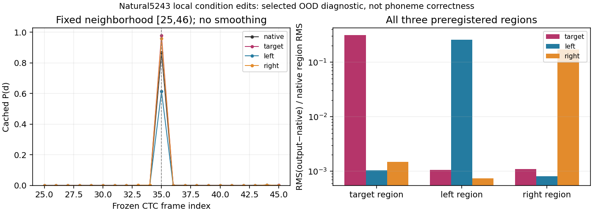

# Natural5243 local-condition diagnostic

Completed in 53.17831seconds,0frontend/4OFF N30/4short existing-recognizer calls. No failures,inference retries,Router,training,downloads,window/threshold/seed changes or additional cases. All four results are retained. Artifact size is about13.8MB,below30MB;runtime is below240seconds.

The preregistered target-necessity direction is not supported by this recognizer measurement: target removal increases fixed/nearby support,while the equal-energy left control reduces it. All four still identify d as top1 at frame35. This does not establish a true phoneme deletion or recovery outcome.

|Arm|FixedP(d),[35,36)|Nearbymax,[25,46)|Nearbymean|Peak frame|d-top1 nearby frames|Δ=native−arm,fixed|
|---|---:|---:|---:|---:|---|---:|
|native|0.86961740|0.86961740|0.04172996|35|[35]|+0.00000000|
|target|0.97922212|0.97922212|0.04676902|35|[35]|-0.10960472|
|left|0.61450481|0.61450481|0.02956291|35|[35]|+0.25511259|
|right|0.95915562|0.95915562|0.04607581|35|[35]|-0.08953822|

Preregistered contrast Δtarget−max(Δleft,Δright)=-0.36471730. The left control has the greatest downward fixed posterior effect (+0.25511259);target has −0.10960472 and right −0.08953822. Nearbymean changes have the same direction:target -0.00503906,left +0.01216705,right -0.00434586. Fixed-frame and nearbymax peaks remain35,so there is no measured peak relocation within the frozen neighborhood. No success threshold,p-value,bootstrap,PER or recovery rate is assigned. This is a single selected event and cannot establish noise irrelevance or that the backend never uses direct noisy speech.

Full serialized-clip free greedy CTC sequences,not human transcripts:

- native: `ɛ l f ɛ s t ɪ m eɪ d ɪ ŋ d m aɪ w ɜː θ`
- target: `ɛ l f h ʌ z d m eɪ d h ɪ m d m aɪ w ɜː θ`
- left: `ɛ l f ɛ s t ɪ m eɪ d ɪ ŋ d m aɪ w ɜː θ`
- right: `ɛ l f ɛ s t ɪ m eɪ d h ɪ m d m aɪ ð w ɜː θ`

The full sequences vary outside the fixed d target,so single-frame posterior is not a full-content score. Candidate interpretations must retain classifier/global normalization/context sensitivity; no new listening request/page was created.

The left plot shows every frame25–45 with no smoothing or new window selection. The right plot normalizes output-difference RMS to native RMS in each corresponding fixed region;this visual scale is descriptive,not a statistical effect size.

|Edited condition|OutputΔRMS in target19.35–19.55s|OutputΔRMS in left18.81–19.01s|OutputΔRMS in right19.83–20.03s|Outside all three RMS|
|---|---:|---:|---:|---:|
|native|0|0|0|0|
|target|0.0016764406|8.8911095e-06|6.4574498e-06|2.8461775e-05|
|left|5.6387811e-06|0.0021304532|4.7627585e-06|4.1152838e-05|
|right|7.9948666e-06|6.2176641e-06|0.0010038902|4.0486003e-05|

Target removal changes target waveform RMS by1.67644e−3,whereas left/right removal changes that same target region by5.63878e−6/7.99487e−6. Despite this much smaller target-region waveform change,the left control lowers targetposterior most. Outputs also have nonzero differences beyond edited windows. Waveform magnitude is not a phoneme correctness score,and this contrast does not isolate acoustic evidence extraction from recognizer context or clip-wide normalization.

|Arm|2sPCM clip mean|2sPCM clip RMS|2sPCM clip std|Processor input RMS|
|---|---:|---:|---:|---:|
|native|-3.4986496e-05|0.0060185817|0.00601848|0.99862247|
|target|-3.451252e-05|0.0059376309|0.0059375306|0.99858474|
|left|-3.5511971e-05|0.0057391987|0.0057390888|0.99848545|
|right|-3.6081314e-05|0.0058958964|0.005895786|0.99856475|

All recognizer calls used exactly the original18.75–20.75s serializedPCM16 clip and same official Wav2Vec2Processor/ForCTC,with no added normalization. Processor performs clip-wide normalization;the encoder contextualizes frames over the clip. Therefore local audio edits can alter target posterior through global input statistics/context even where the waveform difference is tiny. No alternate normalization or re-alignment was run. Cached model geometry is99×392;all logits,full softmax probabilities and greedy IDs are retained,including non-target classes.

Input design was fixed before outputs:200ms target[309600,312800),left[300960,304160),right[317280,320480),internal320-sample(20ms)raised-cosine edges. Control selection used clean energy/time only;alpha target1,left0.8688384058650895,right0.9666585492603262. All ideal removals match squaredL2energy0.14454430003522467;actualfloat32relative errors are≤3.35e−9. Each condition is bitwise original outside its selected window and retains originalpeak0.431304931640625. Physical-noise amplitude/source remains fixed within recorded float32roundoff and PCM mixture bounds. Masks,ideal removed clean segments and actual rounded segment deltas are saved;full input conditions are reproducibly hashed instead of duplicating sourceaudio.

Native backend gate passed before any intervention:fullraw exactly matches recovered attempt02 baseline,full30sPCM bytes/samples and2scontext bytes/samples exactly match historicalOFF. Every variant uses the same frozenfloatanchor,reference,restored before_backend and before_sampler CPU/CUDA RNG,first predictor-before x_t hash/time,post-predictor callback RNG and end-backend RNG consumption. All4 haveNFE30/30trace callbacks and same sampler settings. Later reverse trajectory equality is neither required nor implied. Callback RNG is predictor-after and is not mislabeled initial-state RNG.

Native recognizer gate also passed:all oldcached target-token columns match with maximumdifference0.0 (tolerance1e−5),and all99frameargmax IDs agree. Thus current native measurement is exactly faithful to the prior cache for stored columns. New logits/full probabilities are retained for all4outputs. Independent CPU validation rehashes56nonweight sources,verifies actual runtimepre/post hashes for checkpoint and classifier weights,all12frozen execution files and56supervisor-manifest entries;it reconstructs3input conditions and all energy/outside/peak/noise guards,verifies raw/PCM serialization/native gates,paired anchor/RNG/firststate guards,and recomputes all4softmax arrays/fixed/nearby scores/greedy IDs/region waveform deltas. Maximum float64-versus-savedfloat32softmax difference is<4e−7. See artifact_validation.json and validate_completed_run.py. The initial validation draft's syntax-only mistake was detected by AST check before validation;it remains as a supervisor-captured artifact,with the corrected standalone checker used for the passed audit. No model/execution sources were modified.

Actual source/core/checkpoint/classifier58locks were hash-checked before and after execution,all unchanged. The12prepared execution files,selection andRootanalysis_plan remain frozen. Existing dirty workspace,data/weights/listeningserver were preserved. No rootplan edit,commit or push.

Interpretation boundary:the200ms target brackets an oldcleanCTCproxy,not manually isolated/d/;anchor retains speech whiledirectcondition loses knowncleancontribution,making the jointinputOOD. Two position controls match perturbation energy but not phonetic content or intelligibility. The observed targetincrease/leftdecrease does not support the fixed target-necessity direction and points to positional/contextual proxy dependence within this diagnostic;it does not prove a physical mechanism or natural noisy independent recoverability. All four calls finish the registered scope;no posthoc new seeds,boundaries,strengths or controls are introduced. Research Lead decides next direction separately.
