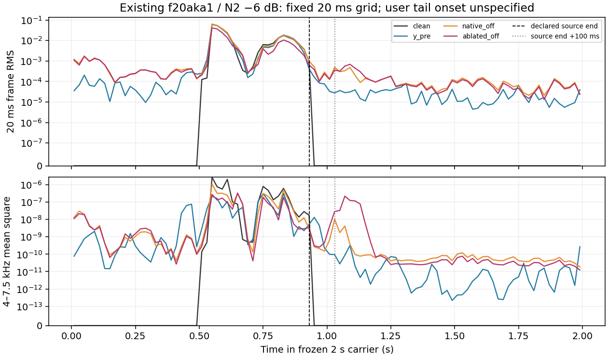

# Case5 existing tail audit

Completed CPU-only on saved artifacts, with zero model initialization, inference/training, downloads or audio output. User's case5 comment is recorded in the original completion JSON and hashed here:

> 消融后端语音末尾加了个明显的/s/辅音，y_pre末尾没有一点声音，原始后端末尾有相对轻微的声音，但不似人声。

The listener supplied no exact /s/ timestamp. We use only the frozen clean recording support and a prespecified100ms guard, never a window selected to match the report. Case4's distinct t→k observation is not analyzed as another audio case here.

The actual recorded clean length is6881 resampled samples, inserted at8000 in a32000-sample16kHz carrier. Declared source interval is[8000,14881),0.5–0.9300625s. Clean padding before and after this interval is bitwise zero. Raw clean(float64),Y_pre/native/ablated(float32),original manifests,noise recipe,source WAV,source proof,vocabulary,model JSON and cached logits are real and hashed before/after. Native replay raw/WAV hashes exactly match the original fresh-speaker OFF. All arrays share carrier indexing; no resampling or delay compensation was applied. This proves preparation/crop provenance, not absence of generated timing shifts.

|Fixed interval|Arm|RMS|4–7.5kHz mean-square|
|---|---|---:|---:|
|0.9300625–2.0s|clean|0|0|
|0.9300625–2.0s|y_pre|4.230339e-05|4.0737123e-10|
|0.9300625–2.0s|native_off|0.00017172472|3.6739779e-10|
|0.9300625–2.0s|ablated_off|0.00018774381|1.147687e-08|
|1.0300625–2.0s|clean|0|0|
|1.0300625–2.0s|y_pre|2.8754763e-05|2.3623728e-11|
|1.0300625–2.0s|native_off|0.00013953961|3.6919269e-10|
|1.0300625–2.0s|ablated_off|0.0001783306|1.2399713e-08|

|Fixed interval|Ablated−native difference RMS|Ablated/native highband ratio|
|---|---:|---:|
|after_declared_support|0.00011343832|31.2383|
|after_declared_support_plus100ms|0.00011296299|33.5860|

The highband increase is measured in both fixed post-support intervals; it is not a phoneme identity detector. Existing coarse1.3–2s RMS decreases from8.16325e−5 to7.00078e−5 despite the listener's extra/s/report. Lower overall energy does not contradict additional structured sound. All100 disjoint20ms frames per arm, including zero-clean frames, are retained in frames20ms.csv. The figure shows that entire fixed grid without labelling an acoustic /s/ onset.

Highband uses an unwindowed rectangular one-sided FFT, inclusive4–7.5kHz bins, weight1 at DC/Nyquist and2 at other positive frequencies: sum(weight×|FFT|²)/N². Total weighted spectrum was checked against mean(x²) for every frame/interval and difference waveform. A5kHz unit sine gives mean-square0.5. This is finite-segment spectral energy with possible leakage, not a perceptual sibilance score.

|Existing cache|24-way center class|Full greedy collapsed nonblank tokens|Guarded-tail mean /s/ posterior|Guarded-tail max /s/ posterior|
|---|---|---|---:|---:|
|native_off|ch|r a r tʃ a k|3.0605904e-06|3.3763277e-05|
|ablated_off|ch|r a r tʃ a θ s|0.014264879|0.67217165|
|y_pre|k|a r k a|2.7386159e-06|4.1095645e-05|
|clean|k|a k a|2.2343234e-05|0.000129001|

Both native and ablated center scores remain ch, yet their cached full-vocabulary greedy sequences differ at the tail. In ablated output,s is argmax only at frame53 with posterior0.67217; native and frontend have no s-argmax tail frames. Model convolution geometry is stride320samples/receptive field400samples: frame53 has support1.060–1.085s, center1.0725s. This is a cached-model proxy location, not a listener-supplied boundary; subsequent transformer context is global. Full99-frame vocabulary logits/probabilities exist for native/ablated/frontend/clean, and all per-frame /s/,blank and greedy tokens are saved in cached_ctc_frames.csv. No extra classifier calls occurred. The same recognizer and its free decode are not an independent human measurement, and its literal full-token string need not be phonetically accurate. Center-only three-token candidate scoring misses unconstrained extra structure; unchanged ch does not establish full-content equality.

Reconstructing the frozen float64 clean+physical noise and casting tofloat32 reproduces the original noisy hash; casting the same physical noise reproduces the actual ablated-condition hash. The two conditions are exactly identical at every sample outside[8000,14881),including both fixed tail intervals. Native/ablate raw and normalized anchor,reference,seed,CPU/CUDA RNG,initial xT and normalized physical-noise hashes all match; NFE/trace counts are30/30. Thus changed output padding can be a nonlocal response to removing earlier speech while preserving local tail condition and anchor. This static provenance fact does not identify the phoneme-generation mechanism.

The intervention removes the whole VCV only from the direct noisy condition, while speech remains in the frontend anchor. It is clean-aware OOD, not a deployable method, isolated consonant removal or proof of independent noisy recoverability. The listener report and cached proxy are consistent about additional tail structure; this single selected,nonblind example provides no insertion rate or population improvement estimate. No new listening request/page/cases were created. Root Research Lead retains interpretation and next-direction decisions; root plan was not edited. Existing dirty files were preserved. Reproduce audit_tail.py then finalize_tail.py only in a distinct fresh destination; the first script refuses existing metrics. All source locks rechecked before final record.
